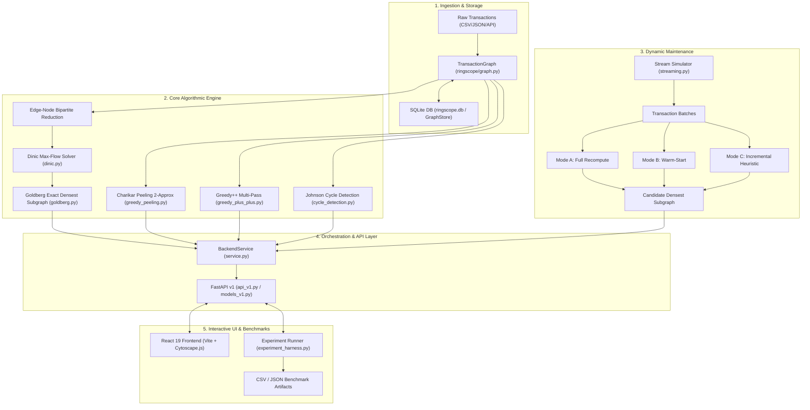

# 02 — Architecture and Data Flow

**Project:** RingScope  
**Document:** System Architecture, Data Flow, Representation Invariants, and Lifecycle  
**Verification Level:** `SOURCE-VERIFIED` / `TEST-VERIFIED`  

---

## 1. End-to-End System Architecture

RingScope implements a multi-tier pipeline transforming raw financial transactions into dense subgraphs, circular rings, and interactive visualizations.

---

## 2. Graph Data Model & Representation Invariants

`SOURCE-VERIFIED` [ringscope/graph.py](file:///c:/VS%20code/DAA/ringscope/graph.py#L40-L195)

### 2.1 Graph Representation
The foundational structure is `TransactionGraph`, wrapping an internal NetworkX simple graph:
- **Undirected Mode:** `nx.Graph` (used for densest subgraph analysis, peeling, and streaming maintenance).
- **Directed Mode:** `nx.DiGraph` (used for directed cycle/ring detection and flow-based transaction routing).

### 2.2 Handling of Transaction Realities
1. **Parallel Transactions (Repeated Edges):**  
   Financial accounts frequently transact multiple times. To maintain simple-graph compatibility required by Goldberg and Dinic, parallel transactions between vertices $u$ and $v$ do **not** insert multi-edges. Instead:
   - The unique edge $\{u, v\}$ is created on the first transaction.
   - Subsequent transactions between $u$ and $v$ increment the edge metadata:
     - `tx_count` (integer transaction counter).
     - `amount` (cumulative transaction volume).
     - `timestamps` (list of transaction execution times).
   - This prevents artificial density inflation while preserving complete financial audit trails.
2. **Self-Loops ($u \to u$):**  
   Self-loops do not represent inter-account collaboration. When ingested:
   - The transaction is skipped from creating a graph edge.
   - It is recorded in metadata: `graph.metadata["self_loops_skipped"] += 1`.
   - The transaction record is preserved in the vertex or transaction log for auditing.
3. **Isolated Vertices:**  
   Vertices with degree 0 are tracked in the graph vertex set $V$. During peeling or Goldberg binary search, isolated vertices have degree 0 and are naturally peeled or excluded from dense cuts.
4. **Graph Density Definition:**  
   Density of a nonempty vertex subset $S \subseteq V$ is defined as:
   $$\rho(S) = \frac{|E(S)|}{|S|}$$
   where $E(S)$ is the set of unique undirected edges with both endpoints in $S$.

---

## 3. In-Memory vs. Persisted State

`SOURCE-VERIFIED` [ringscope/storage.py](file:///c:/VS%20code/DAA/ringscope/storage.py#L18-L130), [ringscope/service.py](file:///c:/VS%20code/DAA/ringscope/service.py#L38-L62)

### 3.1 In-Memory State (`BackendService`)
- Active graphs loaded into memory are stored in a dictionary: `self._graphs: dict[str, TransactionGraph]`.
- Active streaming sessions are maintained in: `self._streaming_sessions: dict[str, StreamingSession]`.
- Streaming maintainer instances (`FullRecomputationMaintainer`, `WarmStartedMaintainer`, `IncrementalHeuristicMaintainer`) retain candidate sets and density metrics in memory.
- Execution of heavy algorithms (Goldberg, Dinic, multi-pass Greedy++) is dispatched to worker threads via `asyncio.to_thread()` to prevent blocking FastAPI's event loop.

### 3.2 Persisted State (`GraphStore` / SQLite)
Graphs and transaction logs can be persisted to an embedded SQLite database (default: `ringscope.db` or `:memory:` for tests). The schema consists of three normalized tables:
- `graphs`: `(graph_id TEXT PRIMARY KEY, name TEXT, is_directed BOOLEAN, created_at TEXT, metadata_json TEXT)`
- `accounts`: `(graph_id TEXT, account_id TEXT, metadata_json TEXT, PRIMARY KEY (graph_id, account_id))`
- `transactions`: `(tx_id TEXT PRIMARY KEY, graph_id TEXT, source_id TEXT, target_id TEXT, amount REAL, timestamp TEXT, metadata_json TEXT)`

---

## 4. API Endpoints and Request/Response Architecture

`SOURCE-VERIFIED` [ringscope/api_v1.py](file:///c:/VS%20code/DAA/ringscope/api_v1.py#L45-L250), [ringscope/models_v1.py](file:///c:/VS%20code/DAA/ringscope/models_v1.py#L15-L220)

All endpoints adhere to strict Pydantic v2 validation models:

| Method | Endpoint | Description | Request Schema | Response Schema |
| :--- | :--- | :--- | :--- | :--- |
| `GET` | `/api/v1/health` | Service health check | None | `HealthResponse` |
| `POST` | `/api/v1/graphs/generate` | Synthesize random graph | `GraphGenerateRequest` | `GraphResponse` |
| `POST` | `/api/v1/graphs/import` | Import edges/transactions | `GraphImportRequest` | `GraphResponse` |
| `GET` | `/api/v1/graphs/{id}` | Retrieve graph metadata & sub-elements | None | `GraphDetailResponse` |
| `POST` | `/api/v1/analysis/run` | Execute densest subgraph or cycles | `AnalysisRequest` | `AnalysisResponse` |
| `GET` | `/api/v1/analysis/{id}` | Query prior analysis result | None | `AnalysisResponse` |
| `POST` | `/api/v1/stream/start` | Initialize streaming session | `StreamStartRequest` | `StreamSessionResponse` |
| `POST` | `/api/v1/stream/step` | Advance stream by 1 or $k$ batches | `StreamStepRequest` | `StreamStepResponse` |
| `POST` | `/api/v1/stream/inject-ring`| Inject planted dense ring/clique | `StreamInjectRingRequest`| `StreamInjectResponse` |
| `POST` | `/api/v1/stream/stop` | Terminate streaming session | `StreamStopRequest` | `StreamSessionResponse` |
| `POST` | `/api/v1/experiments/run` | Run benchmark experiment | `ExperimentRunRequest` | `ExperimentRunResponse` |
| `GET` | `/api/v1/experiments/{id}` | Query experiment status/results | None | `ExperimentResultResponse` |
| `GET` | `/api/v1/experiments/{id}/export`| Export CSV or JSON results | None | `FileResponse` / `StreamingResponse` |

---

## 5. Frontend Graph Rendering & Visualization Limits

`SOURCE-VERIFIED` [frontend/src/components/CytoscapeGraph.tsx](file:///c:/VS%20code/DAA/frontend/src/components/CytoscapeGraph.tsx#L45-L125)

The interactive frontend uses Cytoscape.js with a force-directed layout (`cola` or `cose`).

### 5.1 Visualization Limits & Downsampling
Visualizing tens of thousands of transaction nodes in the browser causes severe DOM lag and Canvas frame drops. RingScope implements **priority sampling** with a strict budget:
- **Maximum Rendered Nodes:** Default cap of **200 nodes** (`maxRenderNodes = 200`).
- **Priority Sampling Strategy:**
  1. **Candidate Nodes:** Vertices belonging to the identified densest subgraph or transaction ring are given absolute priority (100% included).
  2. **Planted Nodes:** Vertices injected as planted fraud rings are always included.
  3. **Background Nodes:** If total vertices exceed 200, non-candidate background nodes are deterministically sampled down to fill the remaining budget.
- **Visual Distinction:**
  - Standard accounts: Neutral slate circles.
  - Candidate densest cluster: High-contrast amber/yellow nodes with glowing borders.
  - Planted fraud ring: Crimson/red nodes with thick outline.
  - Cycle edges: Directed crimson arrows.
